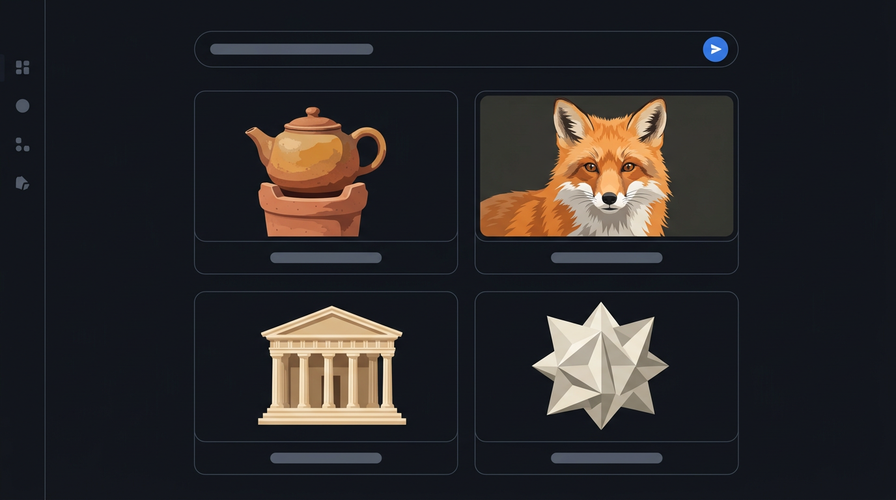

# Image Studio · 图像工坊

**[English](README.md) · [简体中文](README.zh-CN.md)**



一个 DeepSeek Harness 插件：让 **Agent 和人都能调用多家图片 API**，把每一次生成连同提示词、参数和成品一起存进**自带图库**，并在一个专门的 Web 面板里试提示词、做同题多模型对比。

- 侧边栏新增 **图像工坊** 图标，点开即用，不占对话区。
- Agent 通过 5 个工具调用同一套能力；你和 Agent 产生的结果进同一个图库。
- 零运行时依赖：宿主侧只用 Node 内置模块，浏览器侧只用 React（Harness 自带）。

## 安装

这是一个 DeepSeek Harness **bundle 插件**（`package.json` 里声明了 `dsh.bundle`），无需构建、无运行时依赖。

```bash
git clone https://github.com/holynuts/dsh-image-studio.git
```

然后把仓库目录作为一个 bundle 装进你的 profile（Harness 的插件管理 → Install bundle → 选这个目录），或在 profile 的 `cordis.patch.yml` 里插入一行：

```yaml
- insert:
    - id: ui-image-studio
      name: 'dsh-image-studio'
```

装好后刷新一次 Harness Web 界面，侧边栏就会出现 **图像工坊** 图标。

> API Key 不写在本插件的设置里：它走 Harness 的凭据服务（每个服务商一条 ref，优先复用你已配置的 `OPENAI_API_KEY` / `GEMINI_API_KEY` 等）。详见 [§2](#2-api-key-放在哪设计选择)。

---

## 1. 支持的服务商

| provider id | 服务商 | 默认模型 | 说明 |
|---|---|---|---|
| `gemini` | Google Gemini / Nano Banana | `gemini-nano-banana-2.1` | Interactions API；也提供 Nano Banana Pro / 2 / 2 Lite；1K/2K/4K、最多 14 张参考图 |
| `openai` | ChatGPT Image | `gpt-image-2.5-flare` | `/v1/images/generations` + `/v1/images/edits`；Flare / Sunburst；low→max 质量档 |
| `vertex` | Google Vertex AI | `gemini-nano-banana-2.1` | `generateContent` + ADC（与 DSH 的 `google-vertex` provider 共用同一套凭据）；无需在这里填 key；也支持 Vertex Express API key |
| `fal` | fal.ai | `fal-ai/nano-banana-2.1` | 模型 slug 可改成任意 fal 端点；`sync_mode` 直接回 data URI |
| `replicate` | Replicate | `google/nano-banana-2.1` | `Prefer: wait` + 轮询；输出 URL 自动带 Bearer 下载 |
| `openai-compatible` | 任意 OpenAI 兼容网关 | 自己填 | OpenRouter / LiteLLM / 自建网关 / 本地服务 |
| `mock` | 离线占位 | `mock-1` | 不联网、不要密钥，用于先摸清面板与图库流程 |

### Vertex 的模型与区域（2026-10 实测）

| 模型 id | 区域 | 说明 |
|---|---|---|
| `gemini-nano-banana-2.1` | `global` | Nano Banana 2.1，1K/2K/4K，最多 14 张参考图 |
| `gemini-3-pro-image` | `global` | Nano Banana Pro；注意不是 `-preview` 后缀 |
| `gemini-3.1-flash-image` | `global` | Nano Banana 2 |
| `gemini-2.5-flash-image` | `us-central1`（也支持 `us-east5` / `global`） | 第一代 |

3.x 图片模型只挂在 `global` 端点；`us-central1` / `us-east5` 会 404。插件按模型自动选区域，也可以在设置里用 `location` 覆盖。

模型目录是可编辑的：面板里能改模型 id，`settings.json` 里也能加自定义模型。厂商改名的速度永远比插件发版快，所以默认值只是起点。

---

## 2. API Key 放在哪？（设计选择）

**结论：插件自己管理，但存在 DSH 的凭据服务里，并且会自动复用你已经为 DSH provider 配好的同名环境变量密钥。**

- 每个 provider 有自己的 ref，例如 `IMAGE_STUDIO_OPENAI_API_KEY`、`IMAGE_STUDIO_GEMINI_API_KEY`。写入走 `ctx.credentials.set()`，落在 Harness 的凭据存储（`~/.dsh/.credentials.yaml` 的加密/私有条目），**不写进插件的 settings.json，也不进日志**。
- 读取时按链式回退：`IMAGE_STUDIO_*` → `OPENAI_API_KEY` / `GEMINI_API_KEY` / `FAL_KEY` / `REPLICATE_API_TOKEN`。所以如果你在 DSH 的 Models 设置里已经配过 OpenAI 或 Gemini 的 key，这里直接就是「已连接」，不用再贴一次。
- 为什么不走 DSH 的 provider 模型目录：那套目录描述的是 **chat/completions 路由**（provider + model + reasoning effort），图片接口的端点、鉴权头、尺寸/质量参数、异步任务形态都不一样，硬塞进去只会长出第二套适配层。密钥是唯一真正需要共用的部分，所以只共用密钥。
- 面板「设置」里每个 provider 都有状态（已连接 / 无密钥 / 来自环境变量）、密钥输入框、连接测试和官方取 key 链接。

**Vertex 是例外，不需要你配任何密钥**：它和 DSH 自己的 `google-vertex` provider 共用同一套 Google Application Default Credentials（`GOOGLE_APPLICATION_CREDENTIALS` / `gcloud auth application-default login` / metadata server），项目与区域读 `GOOGLE_CLOUD_PROJECT` 和 `GOOGLE_CLOUD_LOCATION`。插件只为 Vertex 的 REST 调用把这份 ADC 换成 bearer token，不弹登录、不存任何新凭据。

如果 macOS 没给 Harness 「文稿」目录权限（读到 `EPERM`），有两种绕过方式：

1. 把密钥拷到 DSH 目录，插件会立即识别，不用改环境变量、不用重启：`cp ~/Documents/vertex_ai_service_account.json ~/.dsh/vertex-service-account.json`。
2. 或者在「设置 → Google Vertex AI」里填一个 Vertex **Express API key**（不涉及 OAuth，请求走 `aiplatform.googleapis.com` 的 key 模式）。

---

## 3. 面板

侧边栏图标 → 主列打开 **图像工坊**，四个分区：

**创作**

- 左侧参数栏：服务商、模型、画幅（带比例小图标）、分辨率/质量、数量 1–4、种子（骰子随机）、参考图（从图库挑，最多 2 张）。
- 右侧大提示词框：反向提示词可展开、字符计数、最近提示词可点选；`⌘/Ctrl + ↵` 生成。
- 生成中显示计时与取消；结果按轮次堆叠，单图大卡、双图两列、三四图 2×2。
- 每张图悬停可下载、复制提示词、收藏、用作参考图、看详情；点开是灯箱，`←/→` 切换、`Esc` 关闭。
- 空状态给三条示例提示词，点了直接填进输入框。

**图库**

- 搜索提示词、按服务商筛选、只看收藏、时间排序、分页「加载更多」。
- 右侧详情抽屉：大图、提示词复制、参数表、标签、0–5 星、备注、收藏、下载、删除（二次确认）、复制绝对路径、`←/→` 翻页。
- 每张成品都保留：服务商、模型、画幅/尺寸、质量、种子、耗时、来源（面板 / Agent / 对比）。

**对比**

- 同一个提示词最多发给 4 个「服务商 · 模型」目标，并行跑，按列并排显示，含耗时与失败原因。
- 每列可打星、去图库打开、拿回提示词；历史对比运行会存下来，点一下就能重看。

**设置**

- 每个服务商：状态、密钥输入/清除、默认模型、连接测试、可配置端点（fal / Replicate / OpenAI 兼容）。
- 图库位置与统计（条数 / 图片数 / 占用）、打开文件夹。
- 默认参数（服务商 / 模型 / 画幅 / 质量 / 数量），会用于面板与 Agent。

中英文界面跟随 Harness 语言设置。

---

## 4. Agent 工具

| 工具 | 用途 |
|---|---|
| `image_generate` | 按提示词生成，返回 `itemId`、绝对文件路径，并在可用时把图片作为 image block 内联给模型看 |
| `image_library_search` | 按文本 / 服务商 / 模型 / 标签 / 收藏搜图库 |
| `image_library_get` | 读一条完整记录（提示词、参数、路径、评分、备注） |
| `image_library_update` | 收藏、评分、标签、备注 |
| `image_providers` | 列服务商、密钥状态和模型（用户点名 provider/model 时先查） |

插件还会注入一段简短的 system prompt 说明何时该用这些工具、生成要花钱、要看图用 `read_image`。工具结果里没有 base64，只有路径和可渲染的附件引用。

---

## 5. 图库存储

默认 `$DSH_HOME/image-studio`（当前机器：`~/.dsh/image-studio`）：

```
image-studio/
  items/<img_id>.json      # 提示词、参数、评分、标签、来源、图片清单
  images/<img_id>-<n>.png  # 原图
  runs/<run_id>.json       # 对比运行
  settings.json            # 非敏感设置（默认值、端点、自定义模型、UI 偏好）
```

- 文件名只允许 `[A-Za-z0-9._-]`，读取路径校验必须落在根目录内。
- 写入用 `tmp + rename`，列表走内存索引，单进程内一致。
- 生成结果不写入 session log，也不依赖任何一次对话：删掉会话图库还在。
- 想换位置：在 profile 的 `cordis.patch.yml` 给这一行加 `config: { libraryDir: /absolute/path }`。

---

## 6. 自定义接口

任何 OpenAI 形状的网关：设置里选 **OpenAI-compatible**，填 `baseUrl`（例如 `https://openrouter.ai/api/v1`、`http://127.0.0.1:4000/v1`）、模型 id 和 key。请求走 `POST {base}/images/generations`，同时接受 `b64_json` 与 `url` 两种响应。

要接一个全新协议：在 `lib/providers/` 加一个文件，实现 `SPEC.md` §2 的适配器对象，然后在 `lib/providers/index.js` 的 `ADAPTERS` 里注册。适配器只碰 HTTP，不碰磁盘与凭据。

`docs/api-spec-2026-10.md` 是 2026-10 对 10 家图片 API 的核对记录（端点、鉴权头、异步形态、URL 有效期），加新适配器前先读它，能省掉一半试错。

---

## 7. 安全与行为边界

- `/api/image-studio/*` 只接受 **loopback 或已配对设备**；跨站浏览器请求（`sec-fetch-site: cross-site`）直接 403。
- 密钥只出现在发往服务商的请求头里；错误信息会过滤密钥；不写日志、不进 settings、不返回前端。
- 生成会花真钱：工具描述与 system prompt 都要求「不要批量试错」，面板里每次生成都是一次明确点击。
- 删除是物理删除（记录 + 图片文件），界面有二次确认；Agent 侧没有删除工具。

---

## 8. 测试与已知限制

```bash
cd dsh-image-studio
npm test        # 49 个测试：图库 15、适配器 16、服务/工具 7、Vertex 11
```

已验证：

- 单测覆盖图库 CRUD/分页/筛选/损坏文件容错、六个适配器的请求形状与错误包装、服务层生成/对比/凭据/设置、工具输出。
- 实机（当前 profile）：插件安装并激活；`/health`、`/bootstrap`、`/generate`（mock）、`/items`、`/file`、`/download`、`/credentials`（真实写入后清除）、`/credentials/test`（真实打到 OpenAI 并正确报 401）、`/compare`、`/runs` 全部通过。
- **Vertex 实机**：用你机器上的 ADC 成功换到 access token；四个模型全部通过连通性探测；`gemini-nano-banana-2.1` 真实生成一张 1024×1024 PNG（15.1s，入库并可从 `/file` 取回）。
- 真实密钥未提供，因此 `gemini` / `openai` / `fal` / `replicate` 的**成功路径**未做线上实测；Gemini Interactions API 的响应解析按官方文档写成容错扫描（`output_image`、`steps[].content[]`、`inline_data` 多形态）。
- 面板的**视觉渲染**已在后续会话中用真实截图验证；slot 注册（`sidebar.panellist#image-studio`、`main#image-studio`）均 active，客户端 JS 通过语法检查与工厂/注册冒烟。若第一次打开有布局问题，改 `client.js` 的 CSS 区块即可。

Vertex 的 ADC 路径已按 DSH 同款凭据实现并有单测覆盖；把密钥移出「文稿」目录后实测通过（上面的 1024×1024 就是 Vertex 出的）。

尚未做（刻意留在后续版本）：

- 缩略图（当前本地回环直接出原图，网格靠 `loading="lazy"`；图库大到几万张再补）。
- 用 DSH 的文本模型做「提示词润色」。
- Stability / Ideogram / Recraft / BFL / Ark / xAI 适配器（`docs/api-spec-2026-10.md` 已备好参数表）。
